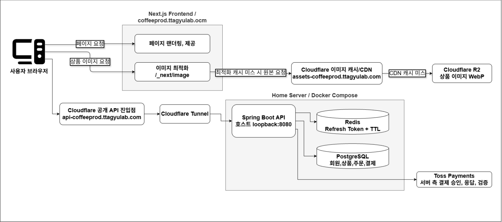
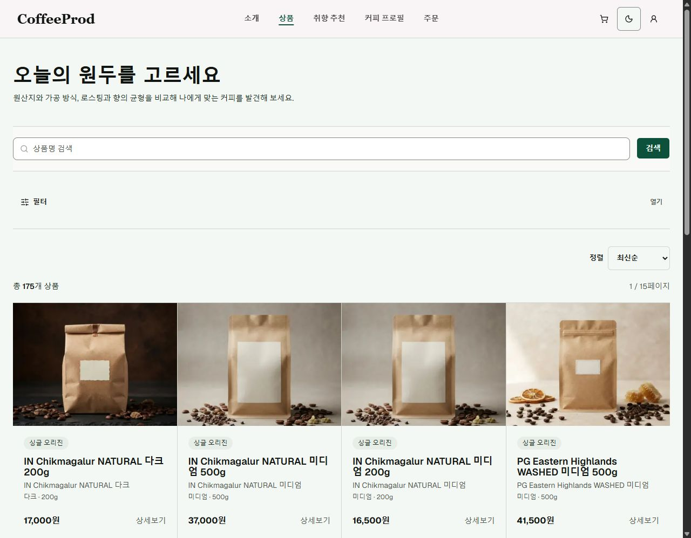
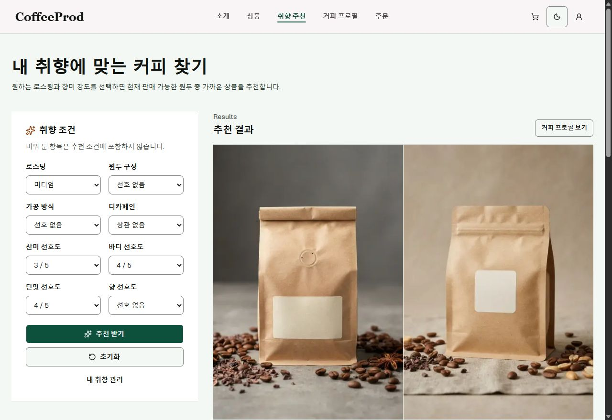

# CoffeeProd

CoffeeProd는 커피 원두를 비교하고, 취향에 맞는 상품을 추천받아 주문하는 흐름을 구현한 포트폴리오 프로젝트다. 원산지·가공 방식·로스팅·향미 정보를 바탕으로 원두를 탐색하고, 장바구니와 결제, 주문 관리까지 이어지는 과정을 담았다.

이 저장소는 Spring Boot 기반 백엔드다. 회원 인증, 상품과 커피 프로필, 취향 추천, 주문·결제 API를 제공하며, 관리자가 카탈로그와 재고를 관리하고 주문·매출 현황을 확인하는 기능도 포함한다.

[CoffeeProd](https://coffeeprod.ttagyulab.com/)

공개 사이트는 기능 시연용이며 실제 상품 판매와 배송은 하지 않는다.

## 기술 구성

저장소의 현재 빌드·설정 기준이다. [로고 출처](docs/icons/README.md)

| 분류 | 기술 |
| --- | --- |
| 언어·빌드 |  Java 27 ·  Gradle 9.9.0 |
| 웹·데이터 접근 |  Spring Boot 4.1.2, Spring WebMVC, Spring Data JPA ·  Hibernate |
| 데이터 저장·변경 관리 |  PostgreSQL 16 ·  Redis 7 ·  Flyway |
| 인증·권한 |  Spring Security ·  JWT · BCrypt · Redis 기반 Refresh Token Rotation |
| 결제 |  Toss Payments · 개발·테스트용 Fake Payment Gateway |
| API 문서·관측 |  Springdoc OpenAPI, Swagger UI ·  Actuator ·  Prometheus |
| 테스트·성능 측정 |  JUnit ·  H2 · PostgreSQL 연동 검증 ·  k6 |
| 배포 |  Docker Compose ·  GitHub Actions ·  GHCR ·  Cloudflare Tunnel |

## 아키텍처

- Next.js가 페이지 제공과 상품 이미지 최적화를 담당하고, 원본 상품 이미지는 Cloudflare CDN과 R2를 통해 제공한다.
- 공개 API 요청은 Cloudflare Tunnel을 거쳐 홈 서버의 Spring Boot로 전달한다. PostgreSQL은 서비스 데이터를, Redis는 Refresh Token과 만료 시간을 관리한다.
- 결제 승인·취소와 결과 확인은 Spring Boot에서 Toss Payments와 연동한다.

## ERD

회원·상품·장바구니·주문·결제의 핵심 9개 테이블을 정리했다. 주문 시점의 가격·배송지 보존과 결제 복구 작업을 함께 볼 수 있도록 주요 컬럼을 표시했다.

[V1~V19 ERD 확대 보기 — 24개 테이블](docs/images/erd.svg) · [핵심 ERD 원본](docs/diagrams/erd-core.mmd) · [테이블 구성과 관계 설명](docs/diagrams/README.md)

ERD는 V1~V19 기준 자료다. 이후 V20의 소셜 계정·인증 권한 테이블과 V21의 회원 토큰 버전 변경은 [현재 migration](src/main/resources/db/migration)을 확인한다.

PK는 기본키, FK는 외래키, UK는 단일 컬럼 UNIQUE 제약이다. 관계는 실제 DB 제약을 따르며, 카테고리·커피 기준정보·리뷰·문의·통계 등 나머지 구조는 전체 ERD에서 확인할 수 있다.

## 서비스 화면

<table width="100%">
  <tr>
    <th width="50%">상품 목록</th>
    <th width="50%">취향 추천</th>
  </tr>
  <tr>
    <td width="50%" valign="top">
      
      
상품명으로 원두를 검색하고, 로스팅·용량·가격을 비교하는 상품 목록이다.

    </td>
    <td width="50%" valign="top">
      
      
로스팅과 산미·바디·단맛 선호도를 선택한 취향 추천 화면이다.

    </td>
  </tr>
</table>

## 주요 기능

| 구분 | 내용 |
| --- | --- |
| 원두 탐색 | 상품 검색·필터·정렬, 원산지·품종·가공 방식·향미·추출 방법 등 커피 프로필 조회 |
| 취향 추천 | 로스팅·원두 구성·디카페인 여부와 향미 선호도에 따른 추천, 추천 점수와 이유 제공, 회원 취향 저장 |
| 회원·장바구니 | 회원가입·로그인과 토큰 재발급, 배송지 관리, 상품 수량·분쇄 옵션 변경 |
| 주문·결제 | 장바구니 기반 주문, 배송비 계산, 마일리지 사용·적립, Toss Payments 승인과 주문 취소 |
| 리뷰·문의 | 구매 이력에 따른 상품 리뷰 작성, 회원당 같은 상품에 리뷰 1개 작성, 상품 문의와 관리자 답변 |
| 관리자 | 회원 등급·상태 변경, 상품·커피 프로필·재고 관리, 주문 상태·배송 정보 관리, 일·월·년 매출 통계와 재집계 |

## 구현에서 다룬 점

### 취향 조건과 추천 근거

사용자가 선택한 로스팅과 향미 선호도를 상품의 커피 프로필과 비교해 추천 점수를 계산한다. 결과에는 상품 정보와 함께 어떤 조건이 맞았는지 보여주는 추천 이유를 담는다. 회원은 취향을 저장해 같은 조건으로 다시 추천받을 수 있다.

추천 후보의 점수 계산에는 필요한 값만 조회하고, 선정한 상품의 상세 정보를 따로 불러온다. 전체 후보의 연관 데이터를 모두 읽던 구조를 바꾸면서 기존 추천 점수와 결과 순서를 유지했다.

### 주문과 결제 상태의 일관성

주문 생성 시 재고와 마일리지를 함께 처리하고, 조건부 재고 차감과 잠금(Lock)으로 동시 주문을 제어한다. 상품 가격과 배송지는 주문 시점의 값으로 보관해 이후 상품·주소 변경이 과거 주문 내역에 영향을 주지 않도록 했다.

결제는 Toss Payments 승인·전체 취소와 연동한다. 요청과 결과를 작업 상태로 기록하고, 응답 시간 초과처럼 성공 여부가 불분명한 경우에는 재고·마일리지를 보존한 채 결제사 조회로 결과를 다시 확인한다. 멱등키와 복구 작업을 통해 중복 요청과 서버 재시작 이후의 처리도 다룬다.

### 조회와 집계 개선

주문 목록은 화면에 필요한 요약 정보만 조회하고, 조회 조건에 맞는 인덱스로 데이터 접근 경로를 개선했다. 매출 통계는 일별로 집계하며, 기간 재집계에서는 범위 조회와 배치 쓰기로 DB 호출을 줄였다. 결제 복구와 통계 작업에는 각각 전용 스케줄러를 두었다.

재고 경합, 결제 복구, 인증·권한 등 주요 흐름에 회귀 테스트를 두고, CI에서는 전체 테스트가 성공한 뒤 같은 소스 리비전의 이미지를 게시하도록 구성했다. 개선 과정의 측정 조건과 결과는 아래 관련 문서에 정리했다.

## 관련 문서

- [OAuth 연동 안내](docs/oauth-setup.md) · [비밀번호 복구](docs/password-reset.md) · [AI 추천](docs/ai-recommendations.md)
- [외부 서비스 정책](docs/integrations/README.md): 서비스 선정 당시 정책과 준비 목록
- [성능 개선 기록](improvement/README.md): 주문 조회와 코드 최적화 과정, 측정 결과와 해석 범위
- [개선 사례와 이미지](improvement/portfolio/README.md): 사례별 문제·변경·검증 조건과 결과
