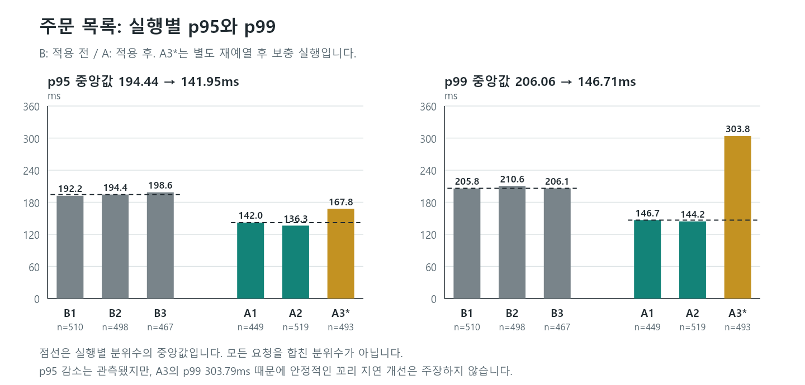
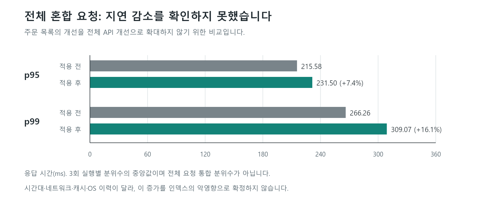
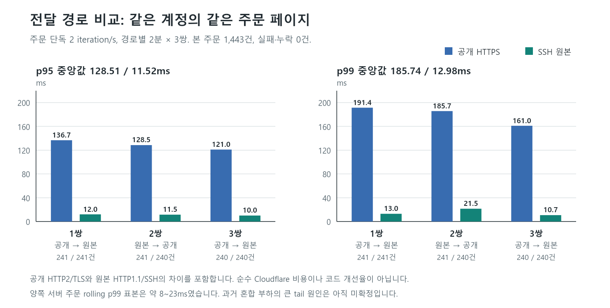

# CoffeeProd 1차 개선 QA 보고서

**검증 → 문제 발견 → 개선 → 재검증 | 주문 조회 인덱스 개선**

측정 기간: 2026-10-07~08(KST). 이 문서는 완료된 한 사이클을 정리한 포트폴리오용 기록입니다. 전체 서비스의 최종 인수나 최대 처리량 검증을 의미하지 않습니다.

## 핵심 결과

주문 15만 건·주문상품 37만 5천 건에서 회원별 주문 조회의 전체 탐색을 확인했습니다. 조회 조건에 맞는 인덱스 2개 적용 후 실행계획이 인덱스 탐색으로 바뀌었고, 반복 측정에서 주문 목록 p95의 중앙값은 **194.44 → 141.95ms, 약 27% 감소**했습니다.

다만 보충 실행의 주문 p99는 303.79ms였고, 전체 혼합 요청의 p95·p99는 높아졌습니다. 따라서 **주문 조회 접근 경로 개선과 p95 감소를 확인했지만, 전체 API나 안정적인 꼬리 지연 개선은 주장하지 않습니다.**

| 확인 항목 | 결과 | 판정 범위 |
|---|---|---|
| SQL 접근 경로 | 전체 탐색 → Index Scan / Index Only Scan | 해당 진단 SQL의 개선 확인 |
| 주문 목록 p95 | 194.44 → 141.95ms | 실행별 p95 3개의 중앙값 비교 |
| 혼합 부하 HTTP 실패·누락 | 전후 모두 0건 | 선정한 완료 실행에서 확인 |
| 로컬 주문 서비스 / 배포 주문 조회 | 7/7 / 13/13 통과 | 선택한 회귀 범위만 확인 |

## 1. 검증: 비교 가능한 기준선 확보

Windows PC에서 k6를 실행하고, Ubuntu의 Spring Boot·PostgreSQL·Redis를 대상으로 측정했습니다. Actuator 지표를 SSH 터널로 전달해 Prometheus에서 CPU·JVM·DB 커넥션 대기·서버 처리 시간을 함께 확인했습니다.

| 조건 | 설정 |
|---|---|
| 서버 | 사용자 제공 기준 3 vCPU, 메모리 2.9GiB; 앱 컨테이너 개별 CPU·메모리 제한 없음 |
| 데이터 | 주문 150,000건, 주문상품 375,000건; 대표 계정 주문 501건 |
| 혼합 시나리오 | 공개 조회 15 + 회원 조회 4 + 로그인 1 iteration/s |
| 측정 | 2분 예열, 5분 본 측정 3회, 실행 간 90초 휴지 |
| 주문 목록 | `GET /api/v1/orders`, page=0, size=10 |
| 비교 경로 | 동일 공개 HTTPS 경로; 주문·결제 생성 부하는 제외 |

전체 혼합 시나리오의 목표는 20 iteration/s입니다. 요청 수와 iteration 수는 다른 지표이며, 회원 시나리오가 무작위로 엔드포인트를 선택하므로 주문 목록 표본 수는 실행마다 다릅니다.

## 2. 문제 발견: 필요한 행보다 넓게 탐색

PostgreSQL `EXPLAIN (ANALYZE, BUFFERS)`로 주문 ID 페이지, 회원 주문 건수, 주문상품 조회를 분리했습니다. 회원 조건·정렬에 맞는 인덱스가 없어 주문 테이블을 병렬 전체 탐색했고, 주문상품 조회에는 375,000행 전체 탐색이 나타났습니다.

이 부하에서 수집한 CPU·커넥션 대기 지표는 CPU 또는 DB 풀 포화를 보여주지 않았습니다. 따라서 서버 증설보다 **실제 조회 조건에 맞는 접근 경로 보완**을 우선했습니다. 이는 N+1 해결이나 쿼리 수 감소 작업과는 다릅니다.

## 3. 개선: 조회 조건에 맞는 인덱스 적용

DEV가 V17 마이그레이션으로 아래 인덱스를 추가했습니다. 사용자가 배포·DB 적용을 수행했고, QA는 정의·유효 상태와 전후 결과를 확인했습니다. 다음은 적용된 정의의 요약이며 재실행 안내가 아닙니다.

```sql
CREATE INDEX idx_orders_member_order_date_desc
    ON orders USING btree (member_id, order_date DESC);
CREATE INDEX idx_order_item_order_id
    ON order_item USING btree (order_id);
```

첫 번째는 회원별 필터링과 최신순 정렬을, 두 번째는 선택한 주문의 상품 조회를 지원합니다. 구현은 [V17 마이그레이션](../../src/main/resources/db/migration/V17__add_order_query_indexes.sql)에 있습니다. 인덱스는 저장 공간·쓰기 비용을 추가하므로 조회 개선만으로 전체 거래 성능을 판단하지 않습니다.

## 4. 재검증: SQL·HTTP·기능을 함께 확인

### SQL 접근 경로

| 진단 SQL | 적용 전 1회 | 적용 후 3회 중앙값 | 확인한 변화 |
|---|---:|---:|---|
| 주문 ID 페이지 | 14.632ms | 0.123ms | 전체 탐색·정렬 → 복합 인덱스 탐색 |
| 회원 주문 count | 14.481ms | 0.152ms | 전체 탐색 → Index Only Scan |
| 주문상품 join(축약) | 77.541ms | 0.642ms | 상품 전체 탐색 → order_id 인덱스 탐색 |


전후 반환 행 수는 각각 10·1·26으로 같았습니다. 적용 전 1회와 적용 후 3회는 캐시 조건이 다르고, join은 축약 진단 SQL입니다. SQL 시간의 큰 감소를 그대로 API 개선 배율로 환산하지 않습니다.

### 주문 목록 HTTP 응답



전후 각 3회 완료 실행의 HTTP 요청은 18,055 / 18,057건, 주문 목록 표본은 1,475 / 1,461건입니다. HTTP 실패·check 실패·dropped iteration은 모두 0입니다. 적용 후 3회차는 중단 실행을 제외하고 **별도 재예열한 보충 실행**입니다.

서버 주문 처리의 1분 rolling histogram p95 표본 범위도 73.60~87.82 → 6.75~13.07ms로 낮아졌습니다. 이는 클라이언트의 5분 p95와 창·계산법이 달라 직접 빼거나 합치지 않습니다.

### 개선되지 않은 지표도 기록



전체 혼합 p95 중앙값은 215.58 → 231.50ms(+7.4%), p99는 266.26 → 309.07ms(+16.1%)였습니다. 시간대·네트워크·캐시·OS 이력이 완전히 통제되지 않았으므로 증가를 인덱스의 악영향으로 단정하지도 않습니다.

### 기능 회귀

로컬 H2 주문 서비스 테스트 7개, 배포 환경 주문 조회·권한 검사 13개, 부하 스크립트 안전성 검사 9개가 통과했습니다. 배포 검사는 목록·페이지·정렬·상세·주문상품 값과 비인증 401·다른 회원 상세 403을 포함합니다. 전체 최신 테스트 스위트 통과를 의미하지 않습니다.

## 후속 진단: 서버 처리와 전달 경로 분리



같은 계정·주문 페이지를 2 iteration/s로 경로별 2분씩 3쌍 측정했습니다. 본 주문 요청 1,443건에서 실패·누락은 0이었고, p95 중앙값은 공개 128.51ms / SSH 원본 11.52ms였습니다. 양쪽 서버 rolling p99 표본은 약 8~23ms였습니다.

이는 공개 전달 경로가 클라이언트 지연에 영향을 준다는 근거입니다. 공개 HTTP/2·TLS와 원본 HTTP/1.1·SSH의 차이도 포함하므로 **순수 Cloudflare 지연이나 코드 개선율이 아닙니다.** 과거 혼합 부하의 큰 p99 원인은 아직 확정하지 않았습니다.

## 결론과 남은 범위

이번 사이클은 실행계획으로 문제를 좁히고, 인덱스 적용 후 SQL·HTTP·기능을 다시 검증한 **주문 조회 개선 사례**로 정리할 수 있습니다. 환경 차이를 고려해 약 27%는 관측된 p95 감소로 표현합니다.

초기 환경 오류, 모니터링 가드 실패, 중단 실행과 JSON 키 순서에 따른 테스트 오탐도 보존했습니다. 실패를 삭제하거나 기준을 낮춰 성공으로 만들지 않았습니다. 원인·제외 기준은 [측정 근거와 한계](EVIDENCE.md)에 정리했습니다.

남은 범위는 혼합 부하 tail 원인 추적, 쓰기 비용과 주문·결제 동시성, 최대 처리량, 전체 회귀·프론트엔드·최종 인수입니다. 최초 보고서는 기존 자료로 작성했으며, 이후 사용자 요청에 따른 A3 재확인은 아래에 별도로 기록했습니다. 데이터 변경은 수행하지 않았습니다.

## A3 후속 재확인

2026-10-08 14:12~14:14 KST에 같은 혼합 부하 재확인을 시도했지만, 예열 전체 p95 630.48ms·p99 1,199.36ms로 기존 지연 기준을 넘었습니다. 5분 본 측정은 시작하지 않았습니다. 기존 A3의 계산 오류나 VM 장애는 입증되지 않아 원본과 대표 비교를 유지했습니다. [후속 결과와 해석](A3_RECHECK_20261008.md)에 예열 실패·서버 지표·판정 기준을 정리했습니다.

포트폴리오 요약: **“주문 15만 건·주문상품 37.5만 건에서 전체 탐색을 진단하고 인덱스 2개를 적용했습니다. 전후 반복 측정으로 주문 목록 p95 중앙값의 약 27% 감소와 선택 범위의 기능 회귀 통과를 확인했으며, 전체 지연과 tail 변동은 별도로 공개했습니다.”**

수치 원본: [정제된 측정 자료](data/metrics.json). 그래프와 문서는 이 폴더에 포함되어 있으며 Git 추적 대상으로 유지합니다.
