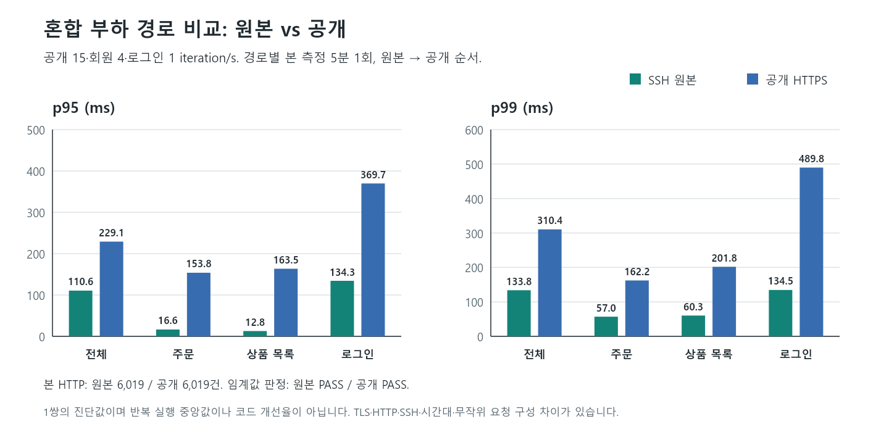

# 2차 혼합 부하 경로 진단 결과

- 실행: `mixed-path-20261008T091853Z`, 2026-10-08 18:18:53~18:37:36 KST.
- 판정: 고정한 예열 2개·본 2개 완료, 각 k6 exit 0/기존 임계값 통과. 진단 완료이며 코드 개선·전체 프로젝트 인수 완료는 아닙니다.
- 실행 입력은 [기존 baseline](../../k6/scripts/baseline.js)과 같은 20개 파일 해시를 사용했습니다. 업무 데이터 쓰기·배포·임계값 변경은 없습니다. 로그인 인증 상태 변경과 조회성 추천 POST는 포함됩니다.

## 본 측정

같은 공개 15·회원 4·로그인 1 iteration/s로 원본부터 실행했습니다. 경로별 2분 예열·5분 본 측정 1회, 단계 간 90초 휴지입니다. 아래는 실행별 분위수이며 반복 실행 중앙값·전후 코드 개선율이 아닙니다.

| 지표 | SSH 원본 | 공개 HTTPS |
|---|---:|---:|
| 본 측정 시각(KST) | 18:22:30~18:27:31 | 18:32:34~18:37:36 |
| HTTP / 성공 check | 6,019 / 12,670 | 6,019 / 12,670 |
| HTTP·check 실패 / dropped iteration | 0 / 0 | 0 / 0 |
| 전체 p95 / p99 | 110.61 / 133.83ms | 229.09 / 310.44ms |
| 주문 표본 / p95 / p99 | 474 / 16.56 / 57.02ms | 460 / 153.80 / 162.20ms |
| 상품 목록 표본 / p95 / p99 | 2,005 / 12.81 / 60.31ms | 2,013 / 163.50 / 201.83ms |
| 로그인 표본 / p95 / p99 | 301 / 134.31 / 134.53ms | 301 / 369.73 / 489.81ms |
| 전체 250ms 이상 | 0건 | 257건(4.27%) |
| 주문 250ms 이상 | 0건 | 2건(0.43%) |

본 측정 합계는 HTTP 12,038건 / check 25,340개입니다. setup·회원 세션 로그인과 실행 경계가 포함되어 목표 iteration 수와 HTTP 건수를 동일시하지 않습니다. 무작위 endpoint 선택으로 주문·상품 표본 수도 다릅니다.

## 지연이 모인 요청

공개 경로의 250ms 이상 257건 중 scheduled login 228건·session login 11건·preflight login 1건, 합계 240건(93.4%)이 로그인 계열이었습니다. 원본 본 측정에는 250ms 이상 요청이 없었습니다. 250ms는 탐색용 분류선이며 상위 1%나 변경한 통과 기준이 아닙니다.

공개 느린 요청의 duration 합계 중 waiting(TTFB) 비중은 99.13%입니다. 공개 느린 주문 2건의 waiting 비중은 96.19%였고 새 TCP·TLS는 0이었습니다. 이 비율은 요청별 기여율·서버 원인 기여율이 아닙니다. TTFB에는 네트워크·프록시·서버·계측 밖 대기가 함께 들어갑니다.

## 서버·클라이언트 대조

본 측정 첫 1분을 제외한 URI별 1분 rolling histogram의 유한 표본은 각 16개입니다. 아래 범위는 클라이언트의 5분 분위수와 창·계산법이 달라 차감하여 순수 네트워크 지연으로 계산하지 않습니다.

| 서버 표본 | SSH 원본 | 공개 HTTPS |
|---|---:|---:|
| 주문 rolling p99 | 10.74~15.01ms | 6.97~18.79ms |
| 로그인 rolling p99 | 111.62~130.86ms | 111.62~129.18ms |
| 앱 process CPU 최대 | 11.08% | 7.06% |
| HikariCP pending 최대 | 0 | 0 |
| Windows 전체 CPU 표본 최대 | 12% | 8% |

이번 표본에서 CPU·커넥션 풀 포화는 나타나지 않았습니다. Windows 표본은 부하 발생기이며 Ubuntu VM 호스트 계측이 아닙니다. 짧은 포화·Tomcat 대기·VM 자원 경쟁을 배제하는 증거도 아닙니다.

## 예열과 기존 A3

| 2분 예열 | 전체 p95 / p99 | 주문 p95 / p99 | 판정 |
|---|---|---|---|
| SSH 원본 | 118.28 / 134.50ms | 58.01 / 67.81ms | PASS |
| 공개 HTTPS | 249.40 / 328.51ms | 166.77 / 326.68ms | PASS |

예열 포함 4단계 합계는 HTTP 16,877건 / check 35,560개이며 실패·누락은 0입니다. 예열을 본 측정에 합치지 않았습니다. 공개 예열의 주문 p99 326.68ms도 보존합니다.

앞선 [A3 후속 예열 실패](../1차개선/A3_RECHECK_20261008.md)의 전체 p99 1,199ms는 이번에 재현되지 않았습니다. 기존 A3 본 측정의 p99 303.79ms는 다른 창·실행이며, 새 값이 낮다는 이유로 무효 처리하거나 대체하지 않습니다.

## 결론과 남은 과제

이번 한 쌍에서는 공개 경로의 클라이언트 지연이 더 크고 서버 로그인·주문 지표는 상대적으로 낮았습니다. **공개 전달 경로와 로그인 계열 tail을 우선 조사할 근거**입니다. 현재 근거만으로 BCrypt·DB·인덱스를 수정할 이유는 확보하지 못했습니다.

원본 HTTP/1.1·SSH와 공개 HTTP/2·TLS의 차이, 순서·시간대·캐시·무작위 요청 구성과 미확인 유지보수 조건이 있습니다. 사용자는 배포·설정·데이터를 변경하지 않았다고 확인했지만 무인 SSH 인증은 실패해 최신 apt·VM 호스트 상태를 조회하지 못했습니다. 수동 출력은 반복 요청하지 않았고 원격 상태를 확인했다고 기록하지 않습니다.

다음은 경로 순서를 교차한 고정 횟수 비교나 같은 시간대의 전송·VM·클라이언트 계측으로 일시 변동과 지속적인 경로 차이를 구분하는 작업입니다. 특정 변경의 필요성이 확인되면 DEV/DevOps에 할당하고 같은 조건으로 개선 전후 반복 검증합니다. **QA TASK 4는 진단 진행 중이며 새 개선 성과는 아직 없습니다.**

## 근거와 검증

각 실행에서 raw의 7개 HTTP timing과 native 건수·분위수, duration 구성 합계, endpoint/window 합계, 허용한 읽기·인증 요청 범위, 서버 주문 p99 bucket 재현을 대조했습니다. 분석 검사 56개가 통과했습니다. 이는 측정 자료의 일치 확인이지 인과관계 증명이 아닙니다.

정제된 [mixed-path.json](data/mixed-path.json)에 4단계·엔드포인트·15초 UTC 완료 창·프로토콜·서버·Windows 표본과 SHA-256을 포함합니다. 계정·토큰·비밀번호·응답 본문은 포함하지 않습니다. 원본은 Git 제외 경로 `k6/results/mixed-path-20261008T091853Z`에 있어 공개 저장소만으로 모든 raw를 독립 재분석할 수는 없습니다.

종료 후 18:39:05 KST의 자동 확인에서 health UP, target UP/lastError 없음/최근 scrape 약 8초, 남은 k6 프로세스 0을 확인했습니다. Ubuntu 수동 상태 출력·설정 변경은 요청하지 않았습니다.

그래프는 실제 본 측정 JSON으로 생성했고 PNG를 열어 한글·수치·축·범례·겹침을 확인했습니다. [검사 기록](data/ARTIFACT_QA.json)은 링크·수치 합계·원본/PNG 해시·UTF-8을 대조합니다.
