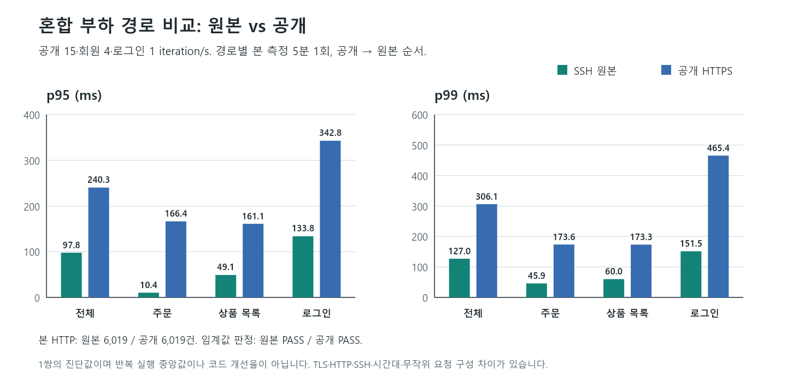

# Cloudflared 계측을 포함한 순서 교차 혼합 비교

- 상태: 최초 시도 중단을 보존하고 QA 계측 판단 보완 후 새 고정 비교 1회를 완료했습니다. 최초 부분 결과는 완료 실행으로 사용하지 않습니다.
- 목적: 첫 원본→공개 비교의 순서를 공개→원본으로 교차하고 터널 지표를 함께 대조합니다.
- 계획: 공개 15·회원 4·로그인 1 iteration/s, 경로별 예열 2분·본 측정 5분 1회, 휴지 90초. 원본 입력과 임계값은 유지하며 실패도 보존합니다.
- 계측: 앱·cloudflared 두 target UP/freshness, 서버 histogram·CPU·GC·DB 대기, Windows 표본, 터널 RTT·연결·프록시 오류를 수집합니다. 패킷 손실 지표가 없으면 미확인으로 기록합니다.
- 범위: 업무 데이터 쓰기·코드 수정·배포·Ubuntu 서비스 변경 없음. 로그인 인증 상태와 조회성 추천 POST는 포함합니다. 현재 JVM heap 약 157MiB/cloudflared RSS 약 40MiB·GC/DB 대기 0을 확인했지만 Ubuntu 전체 RAM·swap은 계측하지 못했습니다.
- 한계: 원본 HTTP1.1/SSH와 공개 HTTP2/TLS, 실행 시각·무작위 요청 구성·미확인 VM/유지보수·추가 exporter 수집이 다릅니다. 순수 Cloudflare 비용·과거 A3 무효·새 코드 개선율로 표현하지 않습니다.

## 최초 시도 보존

`mixed-path-20261008T112918Z`는 공개 예열을 통과했지만 20:37:01 KST(11:37:01 UTC)에 cloudflared metadata freshness 45초 초과 가드에서 중단됐습니다. 공개 본 5분과 원본 단계는 완료되지 않았고 종료 후 남은 k6=0을 확인했습니다. 부분 raw는 보존하며 정식 p95/p99 비교에 넣지 않습니다.

보존된 Prometheus 시계열을 5초 간격으로 재조회한 결과, 전후 샘플 나이는 cloudflared 최대 12.47초·앱 최대 14.99초, 두 up 최소 1이었습니다. cloudflared scrape duration은 최대 0.059초였습니다. 현재 시계 차이는 약 0.05초이고 조회한 Windows 절전·시각 변경 이벤트는 없었습니다. 중단 순간의 API payload가 없어 metadata 판단과 시계열이 불일치한 정확한 원인은 미확정입니다. Ubuntu 메모리 부족·서버 장애로 확정하지 않습니다.

QA 도구는 `up`과 `time()-timestamp(up)`를 같은 Prometheus 시각으로 평가하고 조회 소요시간을 더해 **45초 기준을 유지**하도록 보완했습니다. 실제 down·stale·누락·중복·NaN·응답 지연 등 회귀 14/14와 기술 preflight가 통과했습니다. metadata와 native 판단 자료도 저장합니다. 이는 계측 도구 보완이며 Backend 성능 개선이 아닙니다. 새 시도가 다시 중단되면 추가 자동 재시도 없이 원인을 조사합니다.

## 완료 비교

`mixed-path-20261008T115435Z`, 20:54:35~21:13:19 KST. 예열 2개·본 2개 모두 exit 0/기존 성능 기준 통과입니다. 본 HTTP 12,038/check 25,340, 예열 포함 전체 HTTP 16,876/check 35,558이며 HTTP·업무·인증·check 실패와 dropped iteration은 모두 0입니다.

| 본 측정 | 공개 HTTPS | SSH 원본 |
|---|---:|---:|
| 시각(KST) | 20:58:13~21:03:15 | 21:08:18~21:13:19 |
| HTTP / 성공 check | 6,019 / 12,670 | 6,019 / 12,670 |
| 전체 p95 / p99 | 240.32 / 306.10ms | 97.82 / 127.03ms |
| 주문 표본 / p95 / p99 | 471 / 166.43 / 173.63ms | 518 / 10.37 / 45.90ms |
| 로그인 표본 / p95 / p99 | 301 / 342.79 / 465.39ms | 301 / 133.79 / 151.49ms |
| 전체 250ms 이상 | 247건(4.10%) | 0건 |
| 주문 250ms 이상 | 2건(0.42%) | 0건 |

실행별 5분 분위수입니다. 첫 비교의 순서를 교차한 진단이며 개선 전후 수치·안정적 반복 중앙값·순수 Cloudflare 비용이 아닙니다. setup·세션 로그인도 HTTP 집계에 포함되고 endpoint 선택이 무작위이므로 표본 수가 다릅니다.

## 터널과 자원

첫 1분을 제외한 본 측정의 15초 서버 표본은 경로별 16개입니다. RTT는 연결 4개를 함께 관측하여 경로별 64개 gauge 표본입니다.

| 관측 | 공개 HTTPS | SSH 원본 |
|---|---:|---:|
| connector→edge smoothed RTT | 3~4ms | 4~5ms |
| HA 연결 | 4개 유지 | 4개 유지 |
| 프록시 오류 총량·1분 증가 | 0 | 0 |
| 연결 종료 1분 증가 | 0 | 0 |
| 패킷 손실 지표 | 미제공 | 미제공 |
| JVM heap 표본 | 60.48~155.72MiB | 56.21~162.74MiB |
| 앱 CPU 표본 최대 | 6.92% | 5.85% |
| HikariCP pending 최대 | 0 | 0 |
| 서버 주문 rolling p99 | 6.93~11.63ms | 7.89~23.66ms |

관측 범위에서 메모리·CPU·DB 풀 압박으로 서비스를 종료할 근거는 발견하지 못했습니다. Ubuntu 전체 RAM·swap·VM 호스트는 계측하지 않았으므로 전체 시스템의 압박을 배제하지 않습니다. 서버·DB·터널·모니터링은 유지했고 종료 후 21:14:37 KST에 앱 health UP, 두 target UP/lastError 없음, 남은 k6=0을 확인했습니다.

RTT는 connector→edge 구간입니다. Windows→edge·edge 처리·서버 계측 밖 대기까지 포괄한 클라이언트 시간과 차감하거나 직접 대응시키지 않습니다. 패킷 손실 시계열이 없어 손실 0으로 표기하지 않습니다. 15초 표본은 순간적인 이상을 놓칠 수 있고 counter `increase`는 창의 추정 증가량입니다.

## 결론과 검증

첫 원본→공개 비교에서 전체 p99는 133.83/310.44ms, 이번 공개→원본은 306.10/127.03ms였습니다. 순서를 바꿔도 공개 경로의 클라이언트 지연이 높았습니다. 이번 connector RTT·프록시 오류·연결·서버 지표에는 큰 이상이 관측되지 않아, 단순 DB/BCrypt/메모리 튜닝보다 **클라이언트→edge·edge 처리 및 계측 밖 대기**를 구분하는 것이 다음 후보입니다. 정확한 원인이나 Cloudflare 단독 책임은 확정하지 않습니다.

원본 A3와 앞선 1초대 예열 실패는 그대로 보존하며 새 결과로 대체하지 않습니다. Backend 코드·DB·프로토콜·Ubuntu 서비스는 변경하지 않았습니다. 현재 확보한 개선은 QA 계측 판단 보완이며 새 Backend 성능 개선 사례는 아닙니다.

raw/native 타이밍·분위수·합계·읽기 범위·서버 histogram·터널 UP 검사 60개가 통과했습니다. native freshness 판단 37개 관측의 보수적 샘플 나이 최대는 15.01초였고 metadata와 native의 45초 판단 불일치는 이 완료 시도에서 0개였습니다. 이는 최초 중단 payload나 그 원인을 복원하는 증거가 아닙니다.

[정제된 측정 자료](data/mixed-path-with-cloudflared.json) · [freshness 관측 검증](data/monitoring-freshness-validation.json) · [문서·그래프 검사](data/CLOUDFLARED_ARTIFACT_QA.json). 원본·중단 파일은 Git 제외 `k6/results` 경로에 보존했습니다. 공개 자료에는 계정·토큰·응답 본문을 넣지 않았습니다.

[첫 혼합 비교](RESULT_20261008.md) | [지표 연결](CLOUDFLARED_METRICS_SETUP.md)
