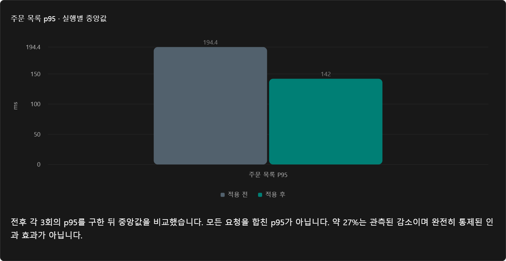
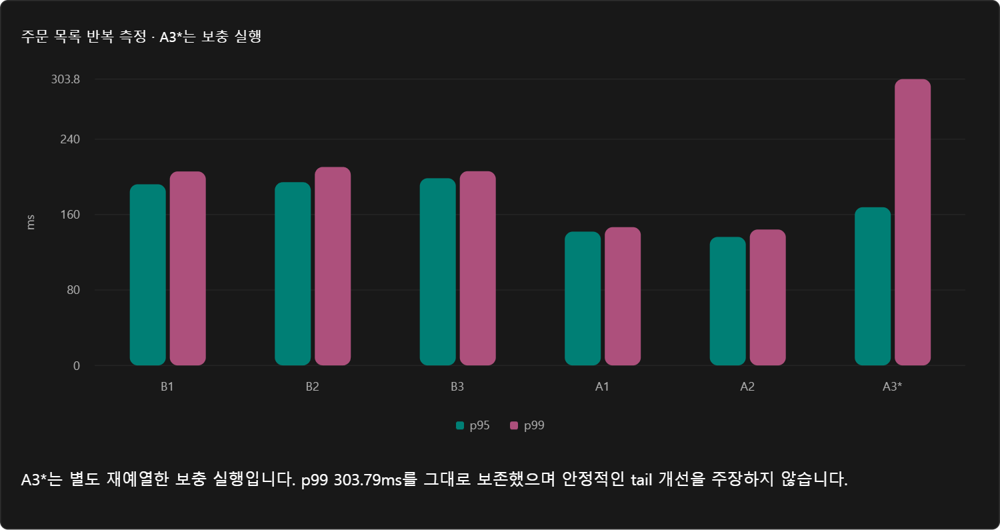
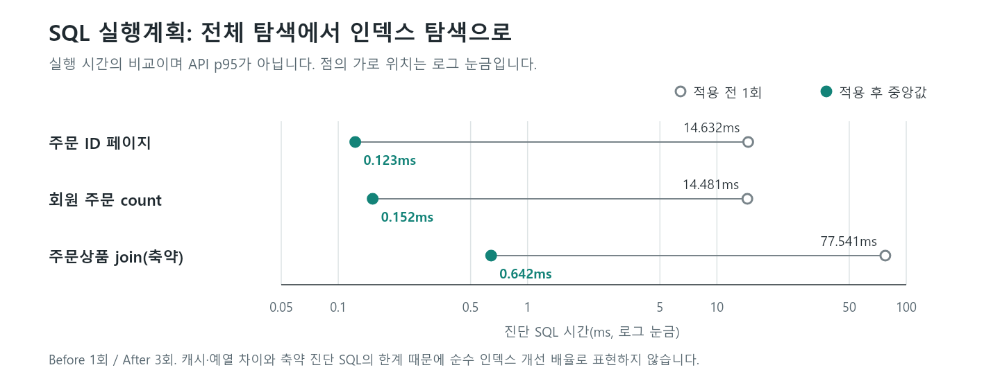
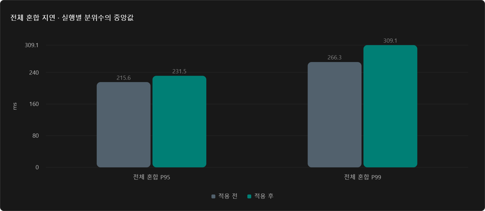
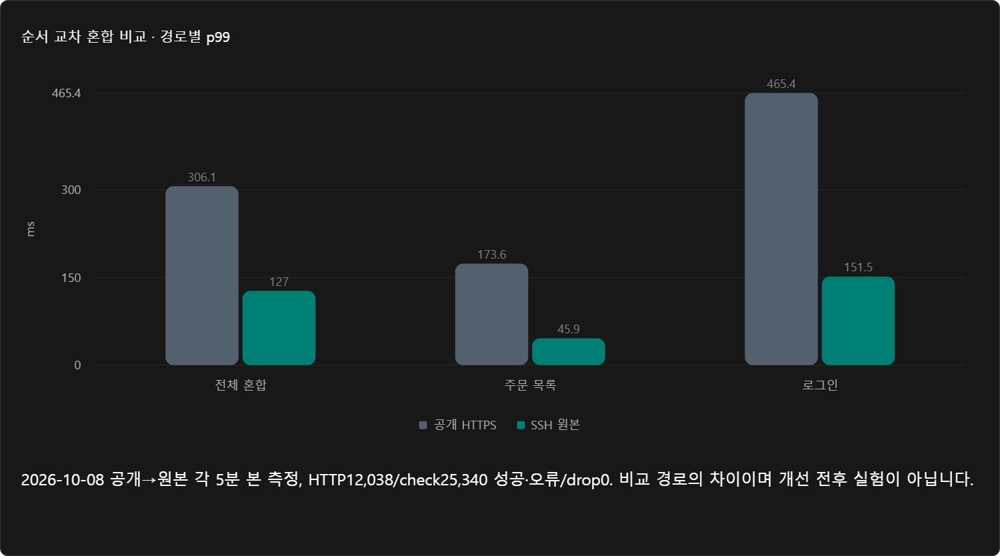
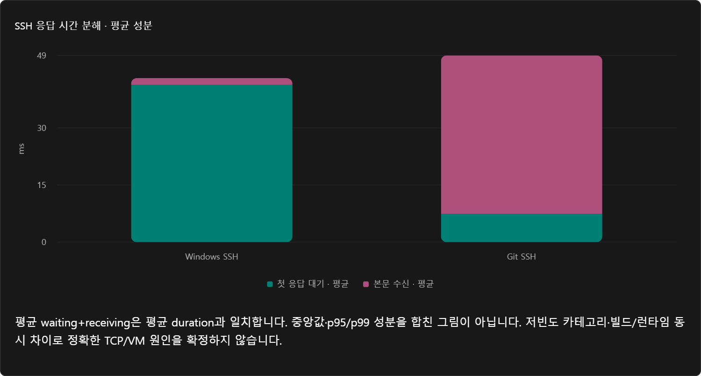

# CoffeeProd 성능 개선 최종 보고서

**주문 조회 개선 성과와 전달 경로 진단의 한계**

측정 기간: 2026-10-07~12 KST. 이 보고서는 1·2차 작업의 최종 정리이며 전체 프로젝트 최종 인수 보고서는 아닙니다. [시각 보고서](http://127.0.0.1:4175/)는 로컬 미리보기 서버가 실행 중일 때 열립니다. 별도로 [단일 HTML 보관본](final-report/CoffeeProd_Performance_Final_Report.html)을 제공합니다.

## 핵심 결론

- **1차는 주문 조회 범위에서 성공했습니다.** 주문 15만 건·주문상품 37.5만 건에서 인덱스 2개 적용 후 주문 목록 p95의 실행별 중앙값이 **194.44 → 141.95ms, 약 27% 감소**했습니다.
- **2차는 진단을 완료했지만 새로운 성능 개선은 확인하지 못했습니다.** 서버 처리와 전달 경로를 분리해 원인 후보를 좁혔고 정확한 근본 원인은 미확정입니다.
- 포트폴리오의 메인은 1차의 **검증 → 문제 발견 → 개선 → 재검증**, 2차는 운영 계측·가설 검증을 보여주는 보조 사례입니다.

| 사이클 | 성공한 범위 | 확인하지 못한 범위 | 활용 |
|---|---|---|---|
| 1차 주문 인덱스 | SQL 접근 경로·주문 목록 p95 개선, 선택 회귀 통과 | 전체 혼합 지연·안정적 p99 개선 | 대표 개선 사례 |
| 2차 혼합 지연 진단 | 공개/원본·클라이언트·계측 구간 분리 | 근본 원인 확정·추가 성능 개선 | 보조 진단 사례 |

## 1차: 주문 조회 개선

### 문제와 변경

회원별 주문 조회에는 전체 탐색·정렬이, 주문상품 조회에는 375,000행 탐색이 나타났습니다. 수집한 CPU·DB 풀 지표에서 뚜렷한 포화를 확인하지 못해 서버 증설보다 조회 조건에 맞는 접근 경로를 우선했습니다. DEV가 [V17](../src/main/resources/db/migration/V17__add_order_query_indexes.sql)으로 아래 인덱스를 추가하고, 사용자가 배포·DB 적용, QA가 전후 검증을 수행했습니다.

```sql
-- 실제 적용 정의의 요약이며 재실행 안내가 아닙니다.
CREATE INDEX idx_orders_member_order_date_desc
    ON orders USING btree (member_id, order_date DESC);
CREATE INDEX idx_order_item_order_id
    ON order_item USING btree (order_id);
```

이는 N+1 해결이나 SQL 개수 감소가 아닌 **회원 필터·최신순 정렬·주문상품 FK 조회의 접근 경로 개선**입니다.

### SQL·HTTP·기능 재검증



전후 각각 3회 실행의 p95를 산출한 뒤 중앙값을 비교했습니다. 전체 요청을 합친 p95가 아니며, 약 27%는 환경 차이를 포함한 관측된 감소입니다.



| 진단 SQL | 적용 전 1회 | 적용 후 3회 중앙값 | 접근 경로 변화 | 반환 행 |
|---|---:|---:|---|---:|
| 주문 ID 페이지 | 14.632ms | 0.123ms | 전체 탐색·정렬 → Index Scan | 10 |
| 회원 주문 count | 14.481ms | 0.152ms | 전체 탐색 → Index Only Scan | 1 |
| 주문상품 join(축약) | 77.541ms | 0.642ms | 상품 전체 탐색 → FK 인덱스 조회 | 26 |



SQL은 캐시·예열 조건이 다르고 join은 축약 진단입니다. 큰 SQL 감소 배율을 그대로 API 개선 배율로 환산하지 않습니다. 인덱스 저장 공간·쓰기 비용은 별도 검증 대상입니다.

| 검증 | 적용 전 | 적용 후 | 판정 범위 |
|---|---:|---:|---|
| 혼합 본 측정 HTTP | 18,055건 | 18,057건 | 선정 완료 실행의 오류·check 실패·drop 0 |
| 주문 목록 표본 | 1,475건 | 1,461건 | 무작위 엔드포인트 선택으로 표본 수 차이 |
| 로컬 H2 주문 서비스 | 비교 지표 아님 | 7/7 통과 | 선택 기능 회귀 |
| 배포 주문 읽기·권한 | 비교 지표 아님 | 13/13 통과 | 페이지·정렬·상세·401/403 |
| 부하 스크립트 안전성 | 비교 지표 아님 | 9/9 통과 | 선정 안전성 회귀 |

### 개선되지 않은 지표



전체 혼합 p95 중앙값은 **215.58 → 231.50ms**, p99는 **266.26 → 309.07ms**였습니다. 적용 후 A3는 별도 재예열한 보충이며 주문 p99 **303.79ms**를 유지했습니다. 시간대·캐시·네트워크·OS 이력이 완전히 통제되지 않아 인덱스의 악영향으로 단정하지 않지만, 전체 API·안정적인 tail 개선도 주장하지 않습니다.

## 2차: 지연 원인 후보를 좁힌 진단

공개 HTTPS와 SSH 원본 혼합 부하를 순서 교차하고, 서버 지표·요청 timing·Ubuntu 내부 조회·TCP 헤더·공유/단독 SSH·Windows/Git OpenSSH를 대조했습니다. **요청 성공과 성능 개선 성공을 구분했습니다.**



위 비교는 2026-10-08 공개→원본 각 5분 본 측정입니다. HTTP 12,038건/check 25,340개 성공·오류/drop 0이었습니다. HTTP/2·TLS와 HTTP/1.1·SSH, 실행 시각 차이가 함께 포함되므로 순수 Cloudflare 비용이나 개선 전후 성과가 아닙니다.



| 단독 SSH, 각 60건 | 중앙값 | p95 | p99 |
|---|---:|---:|---:|
| Windows OpenSSH | 44.19ms | 62.93ms | 64.40ms |
| Git OpenSSH | 54.24ms | 62.98ms | 66.01ms |

클라이언트 교체로 수십 ms 지연을 제거하지 못했습니다. 평균 waiting·receiving 성분은 합산 가능하지만 중앙값·p95/p99 성분은 합산하지 않습니다. 저빈도 카테고리·빌드/런타임 동시 차이와 패킷 귀속·시계 한계 때문에 SSH·클라이언트·TCP/VM은 **우선 후보**이며 확정 원인이 아닙니다. 모든 API·혼합 tail·과거 A3에 같은 원인을 적용하지 않습니다. 요청별 tracing과 SSH 없는 사설망 원본 비교가 다음 별도 조사입니다.

## 포트폴리오 어필 포인트

| 보여줄 역량 | 제시할 증빙 | 설명할 핵심 |
|---|---|---|
| 문제 진단 | k6·실행계획·서버 지표 | 추측이 아닌 근거로 대상을 선택 |
| DB 설계 | 회원·최신순 및 주문상품 FK 인덱스 | 실제 조회 조건에 맞는 접근 경로 |
| 검증 | 전후 반복 측정·기능/권한 회귀 | 효과와 정합성을 함께 확인 |
| 운영 관측 | Ubuntu·Docker·Actuator·Prometheus | 클라이언트 지연과 서버 처리 구분 |
| 판단의 신뢰성 | A3·실패 보존, 미개선 공개 | 근거 없는 튜닝·과장된 성과를 피한 판단 |

대표 사례 제목: **“대량 주문 데이터의 조회 경로 개선과 반복 성능 검증”**. 2차의 상세 SSH·패킷 기록은 부록으로 연결합니다. 기술 역량을 설명할 근거는 있으나 채용 평가 효과를 보장하지 않습니다.

> 주문 15만 건·주문상품 37.5만 건에서 실행계획으로 전체 탐색을 확인하고 조회 조건에 맞는 인덱스 2개를 적용했습니다. 전후 각 3회 측정에서 주문 목록 p95의 중앙값이 약 27% 감소했으며, 선택한 기능·권한 회귀 검증을 통과했습니다. 보충 실행과 환경 차이, 전체 혼합 지연의 미개선도 함께 기록했습니다.

2차는 **“서버 처리와 전달 경로를 분리해 원인 후보를 좁혔고, 근본 원인은 미확정으로 남겼다”**로 표현합니다. “전체 API 27% 개선”, “p99 완전 해결”, “Cloudflare 원인 확정”은 사용하지 않습니다. DEV 구현·사용자 배포·QA 검증과 AI 활용은 실제 본인 역할에 맞게 구분합니다.

## 측정 조건과 남은 범위

| 항목 | 조건 |
|---|---|
| 서버 | 사용자 제공 기준 Ubuntu 3 vCPU·2.9GiB, 앱 개별 CPU/메모리 제한 없음 |
| 구성·계측 | Docker Spring Boot·PostgreSQL·Redis, Windows k6, Actuator→SSH→Prometheus |
| 1차 부하 | 공개15·회원4·로그인1 iteration/s, 같은 공개 HTTPS·주문 page=0,size=10 |
| 반복 조건 | 전후 2분 예열·5분 본 측정 각3회, 휴지90초; after A3는 별도 보충 |
| 데이터 | 주문150,000·주문상품375,000·대표회원주문501건, 변경 없음은 사용자 확인 |

목표20 iteration/s는 HTTP requests/s와 다릅니다. 전체 혼합 tail 원인, 쓰기 비용·주문/결제 동시성, 최대 처리량·장기 안정성, 전체 최신 회귀·Frontend·프로젝트 최종 인수는 미완료입니다. 이 보고서 작성 중 새 부하·배포·DB/운영 설정 변경은 하지 않았고 원본·실패 기록을 교체하지 않았습니다.

## 상세 근거

[1차 상세 보고서](1차개선/README.md) · [원본·제외 기준](1차개선/EVIDENCE.md) · [A3 후속 실패 기록](1차개선/A3_RECHECK_20261008.md) · [2차 진단 개요](2차개선/README.md) · [최종 SSH 진단](2차개선/RESULT_SSH_CLIENTS_20261012.md) · [정제 수치](final-report/data/reviewed-data.json) · [원본 해시 대조](final-report/data/evidence-manifest.json)
