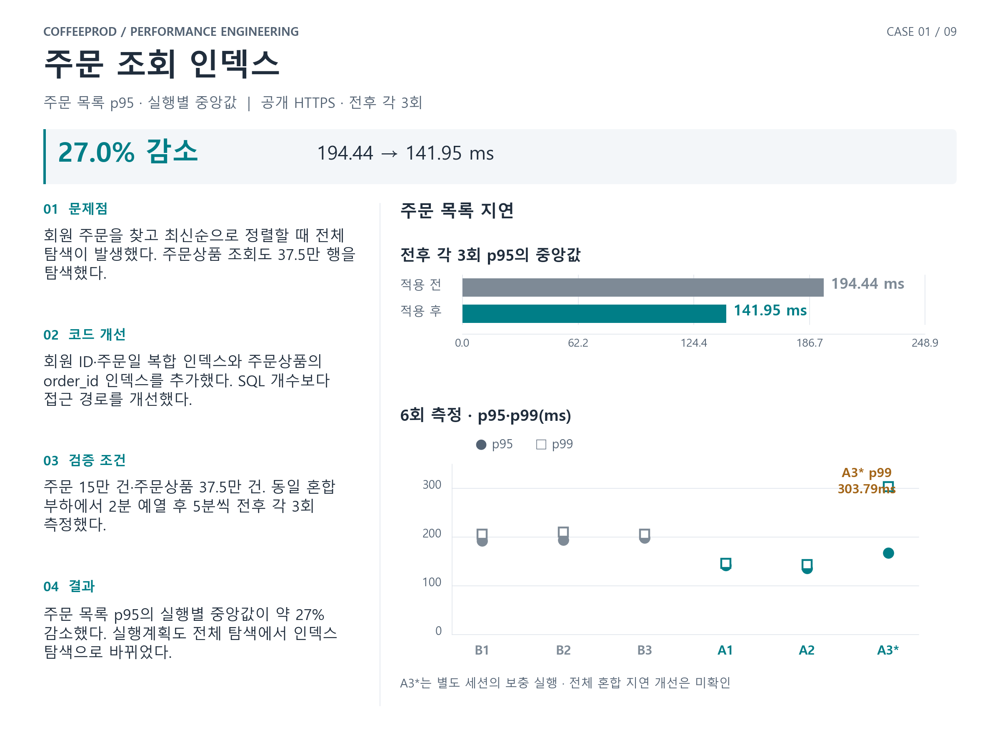
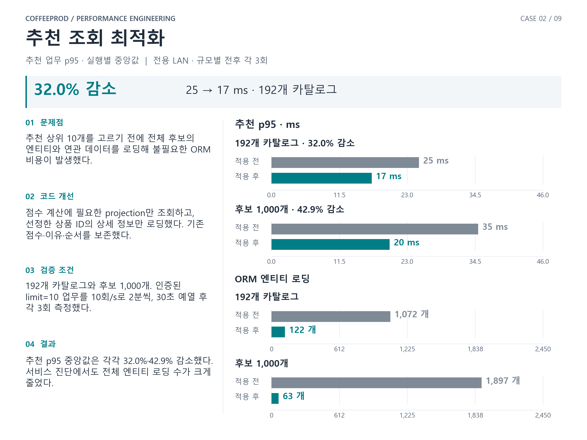
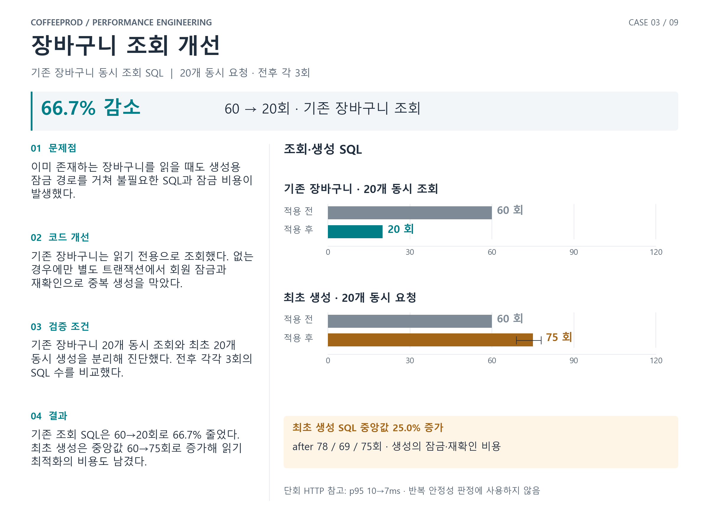
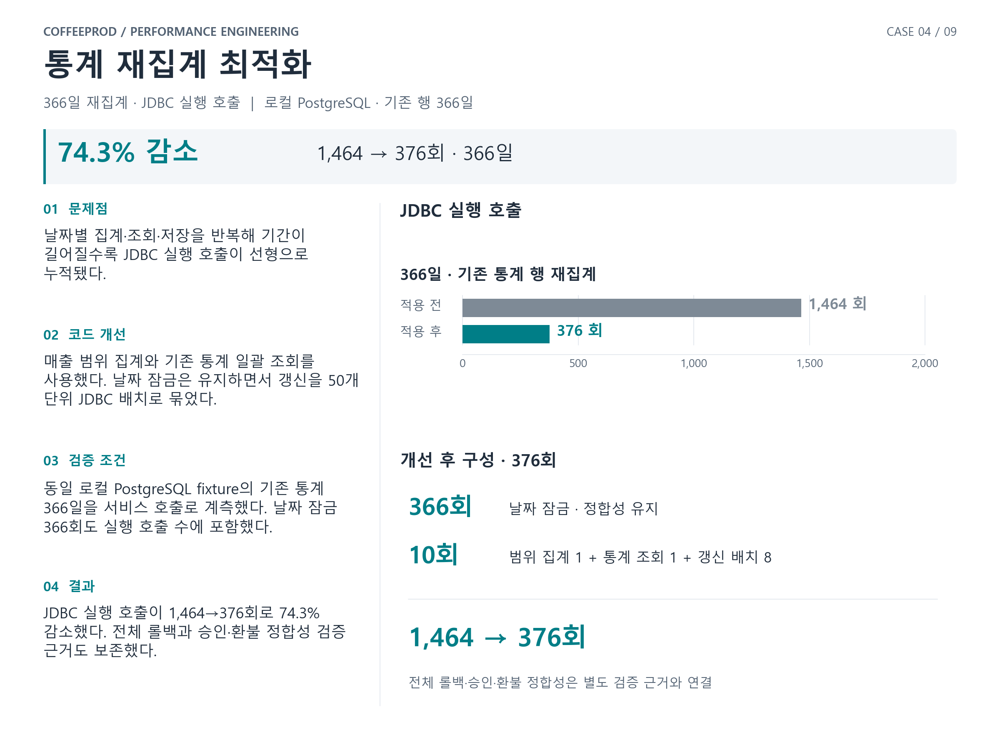
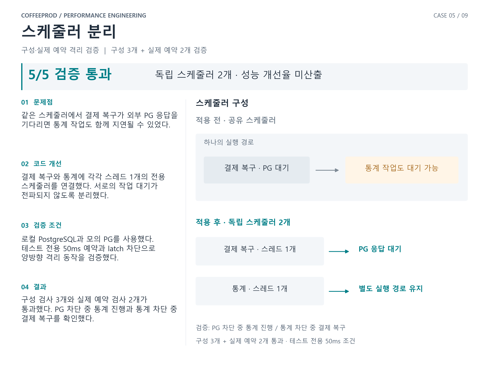
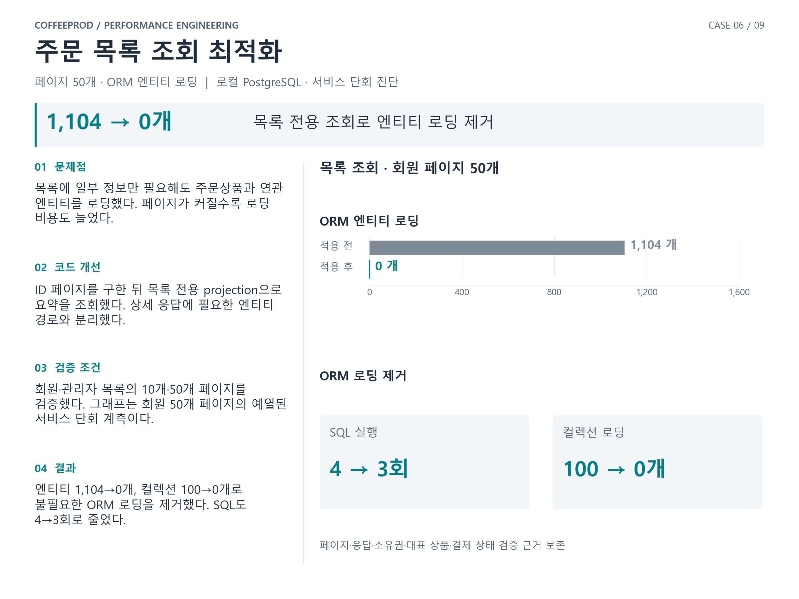
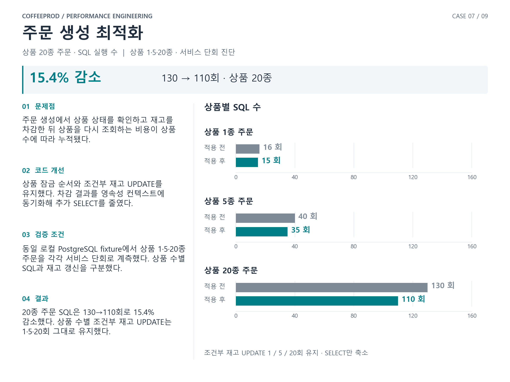
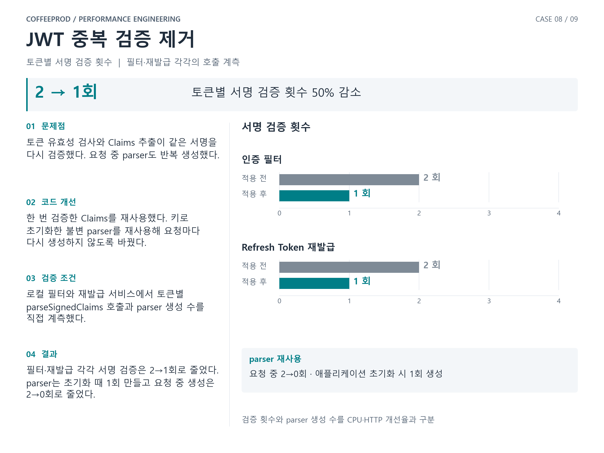
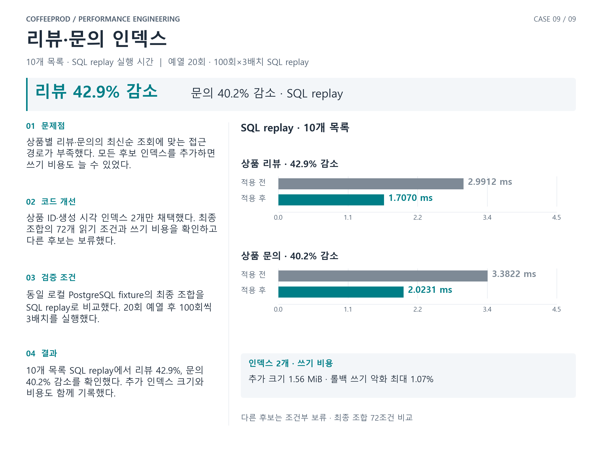

# CoffeeProd 성능 개선 사례 설명

측정은 2026년 10월 7~8일 및 11월 3~4일에 수행했다. 이번 제작에서는 보관 증빙을 읽어 수치와 이미지만 재구성했다. 최신 JDK·프레임워크의 새 성능 측정이 아니다.

HTTP p95는 실행별 분위수의 중앙값이며 모든 요청을 합친 p95가 아니다. SQL 수·JDBC 호출·엔티티 로딩·서명 검증 횟수는 서로 다른 지표다.

## 01. 주문 조회 인덱스

- **문제점:** 회원 주문을 찾고 최신순으로 정렬할 때 전체 탐색이 발생했다. 주문상품 조회도 37.5만 행을 탐색했다.
- **코드 개선:** 회원 ID·주문일 복합 인덱스와 주문상품의 order_id 인덱스를 추가했다. SQL 개수보다 접근 경로를 개선했다.
- **검증 조건:** 주문 15만 건·주문상품 37.5만 건. 동일 혼합 부하에서 2분 예열 후 5분씩 전후 각 3회 측정했다.
- **결과:** 주문 목록 p95의 실행별 중앙값이 약 27% 감소했다. 실행계획도 전체 탐색에서 인덱스 탐색으로 바뀌었다.

| 계측 항목 | 적용 전 | 적용 후 | 단위 |
|---|---:|---:|---|
| 주문 목록 p95 중앙값 | 194.4425 | 141.9501 | ms |

| 실행 | 주문 p95(ms) | 주문 p99(ms) | 주문 표본 |
|---|---:|---:|---:|
| B1 | 192.17 | 205.79 | 510 |
| B2 | 194.44 | 210.55 | 498 |
| B3 | 198.60 | 206.06 | 467 |
| A1 | 141.95 | 146.71 | 449 |
| A2 | 136.32 | 144.19 | 519 |
| A3* | 167.84 | 303.79 | 493 |

전체 혼합 p95 중앙값은 215.58→231.50ms(+7.4%), p99 중앙값은 266.26→309.07ms(+16.1%)였다. 환경 차이가 있어 인덱스의 악영향으로 단정하지 않으며 전체 지연 개선도 주장하지 않는다.

**해석 범위**

- A3*는 별도 재예열한 보충 실행이며 주문 p99 303.79ms를 보존했다.
- 전체 혼합 p95·p99는 증가했다. 환경 차이가 있어 인덱스만의 순수 인과 효과로 해석하지 않는다.

**코드 근거**

- [V17__add_order_query_indexes.sql](../../src/main/resources/db/migration/V17__add_order_query_indexes.sql):78 — `CREATE INDEX idx_orders_member_order_date_desc`

**증빙**

- [EVIDENCE.md](../../improvement/1차개선/EVIDENCE.md)
- [metrics.json](../../improvement/1차개선/data/metrics.json)

**포트폴리오 삽입 문구**

> 주문 15만 건·주문상품 37.5만 건에서 실행계획으로 전체 탐색을 확인하고 조회 조건에 맞는 인덱스 2개를 적용했다. 전후 각 3회 측정에서 주문 목록 p95의 중앙값이 194.44ms에서 141.95ms로 약 27% 감소했다. 전체 혼합 지연과 A3 꼬리 지연의 미개선도 함께 기록했다.

## 02. 추천 조회 최적화

- **문제점:** 추천 상위 10개를 고르기 전에 전체 후보의 엔티티와 연관 데이터를 로딩해 불필요한 ORM 비용이 발생했다.
- **코드 개선:** 점수 계산에 필요한 projection만 조회하고, 선정한 상품 ID의 상세 정보만 로딩했다. 기존 점수·이유·순서를 보존했다.
- **검증 조건:** 192개 카탈로그와 후보 1,000개. 인증된 limit=10 업무를 10회/s로 2분씩, 30초 예열 후 각 3회 측정했다.
- **결과:** 추천 p95 중앙값은 각각 32.0%·42.9% 감소했다. 서비스 진단에서도 전체 엔티티 로딩 수가 크게 줄었다.

| 계측 항목 | 적용 전 | 적용 후 | 단위 |
|---|---:|---:|---|
| 192 catalog products | 25.0000 | 17.0000 | ms |
| 1,000 eligible candidates | 35.0000 | 20.0000 | ms |
| 192 catalog products | 1,072 | 122 | ORM entity loads |
| 1,000 eligible candidates | 1,897 | 63 | ORM entity loads |

**해석 범위**

- HTTP는 JWT 등 일괄 개선의 영향도 포함한다. 추천 변경 하나만의 기여율은 아니다.
- 엔티티 수는 서비스 진단의 전체 ORM 로딩 합이다. HTTP 전체 로딩 수와 구분하며 QA9 전체 after는 미완료다.

**코드 근거**

- [CoffeeRecommendationService.java](../../src/main/java/com/back/coffeeprod/domain/recommendation/service/CoffeeRecommendationService.java):39 — `findRecommendationCandidates`
- [ProductRepository.java](../../src/main/java/com/back/coffeeprod/domain/product/repository/ProductRepository.java):89 — `findRecommendationDetailsByIdIn`

**증빙**

- [comparison.json](../../improvement/code-optimization/evidence/comparison.json)

**포트폴리오 삽입 문구**

> 추천 점수 계산용 projection과 선정 ID 상세 조회를 분리했다. 전용 LAN의 전후 각 3회 부하테스트에서 추천 업무 p95 중앙값은 192개 카탈로그에서 25→17ms(32.0%), 후보 1,000개에서 35→20ms(42.9%)로 감소했다. 추천 결과는 일치했으며 HTTP 결과에는 공통 JWT 개선도 포함한다.

## 03. 장바구니 조회 개선

- **문제점:** 이미 존재하는 장바구니를 읽을 때도 생성용 잠금 경로를 거쳐 불필요한 SQL과 잠금 비용이 발생했다.
- **코드 개선:** 기존 장바구니는 읽기 전용으로 조회했다. 없는 경우에만 별도 트랜잭션에서 회원 잠금과 재확인으로 중복 생성을 막았다.
- **검증 조건:** 기존 장바구니 20개 동시 조회와 최초 20개 동시 생성을 분리해 진단했다. 전후 각각 3회의 SQL 수를 비교했다.
- **결과:** 기존 조회 SQL은 60→20회로 66.7% 줄었다. 최초 생성은 중앙값 60→75회로 증가해 읽기 최적화의 비용도 남겼다.

| 계측 항목 | 적용 전 | 적용 후 | 단위 |
|---|---:|---:|---|
| One matched cart HTTP pair | 10.0000 | 7.0000 | ms |
| Existing cart: 20 concurrent reads | 60 | 20 | SQL statements |
| First cart: 20 concurrent creates | 60 | 75 | SQL statements |

**해석 범위**

- 최초 생성 after SQL은 78/69/75회다. 선은 3회 관측 범위이며 신뢰구간이 아니다.
- HTTP p95 10→7ms는 완료된 단회 쌍의 참고값이다. 반복 안정성이나 전체 경로의 개선으로 확대하지 않는다.

**코드 근거**

- [CartQueryTransactions.java](../../src/main/java/com/back/coffeeprod/domain/cart/service/CartQueryTransactions.java):24 — `findCart`
- [CartQueryTransactions.java](../../src/main/java/com/back/coffeeprod/domain/cart/service/CartQueryTransactions.java):29 — `createCartIfAbsent`

**증빙**

- [comparison.json](../../improvement/code-optimization/evidence/comparison.json)
- [qa9/cart-existing-diagnostics.json](../../improvement/code-optimization/evidence/qa9/cart-existing-diagnostics.json)

**포트폴리오 삽입 문구**

> 장바구니의 기존 조회와 최초 생성을 별도 트랜잭션으로 분리했다. 20개 동시 조회 SQL은 전후 각 3회 모두 60→20회로 줄었다. 반면 최초 생성 SQL 중앙값은 60→75회로 늘었으며, 생성 시 잠금·재확인의 비용을 함께 공개했다.

## 04. 통계 재집계 최적화

- **문제점:** 날짜별 집계·조회·저장을 반복해 기간이 길어질수록 JDBC 실행 호출이 선형으로 누적됐다.
- **코드 개선:** 매출 범위 집계와 기존 통계 일괄 조회를 사용했다. 날짜 잠금은 유지하면서 갱신을 50개 단위 JDBC 배치로 묶었다.
- **검증 조건:** 동일 로컬 PostgreSQL fixture의 기존 통계 366일을 서비스 호출로 계측했다. 날짜 잠금 366회도 실행 호출 수에 포함했다.
- **결과:** JDBC 실행 호출이 1,464→376회로 74.3% 감소했다. 전체 롤백과 승인·환불 정합성 검증 근거도 보존했다.

| 계측 항목 | 적용 전 | 적용 후 | 단위 |
|---|---:|---:|---|
| 366 days; existing rows | 1,464 | 376 | JDBC execution calls |

**해석 범위**

- 376회에는 날짜 잠금 366회와 범위 집계·조회·배치 실행 10회가 포함된다.
- JDBC 실행 호출은 SQL 문 수·네트워크 왕복 수·HTTP 지연과 다른 지표다. 단회 서비스 진단이다.

**코드 근거**

- [SalesStatisticsRangeWriter.java](../../src/main/java/com/back/coffeeprod/domain/statistics/repository/SalesStatisticsRangeWriter.java):26 — `setJdbcBatchSize`
- [SalesStatisticsService.java](../../src/main/java/com/back/coffeeprod/domain/statistics/service/SalesStatisticsService.java):41 — `aggregate`

**증빙**

- [dev9/statistics/structural-metrics.json](../../improvement/code-optimization/evidence/dev9/statistics/structural-metrics.json)
- [dev9/statistics/validation.json](../../improvement/code-optimization/evidence/dev9/statistics/validation.json)

**포트폴리오 삽입 문구**

> 날짜별 반복 접근을 범위 집계·통계 일괄 조회·배치 쓰기로 바꿨다. 기존 366일 통계의 로컬 PostgreSQL 계측에서 JDBC 실행 호출이 1,464회에서 376회로 74.3% 감소했다. 날짜 잠금 366회를 유지한 결과이며 HTTP 지연 개선율을 뜻하지 않는다.

## 05. 스케줄러 분리

- **문제점:** 같은 스케줄러에서 결제 복구가 외부 PG 응답을 기다리면 통계 작업도 함께 지연될 수 있었다.
- **코드 개선:** 결제 복구와 통계에 각각 스레드 1개의 전용 스케줄러를 연결했다. 서로의 작업 대기가 전파되지 않도록 분리했다.
- **검증 조건:** 로컬 PostgreSQL과 모의 PG를 사용했다. 테스트 전용 50ms 예약과 latch 차단으로 양방향 격리 동작을 검증했다.
- **결과:** 구성 검사 3개와 실제 예약 검사 2개가 통과했다. PG 차단 중 통계 진행과 통계 차단 중 결제 복구를 확인했다.

**해석 범위**

- 흐름도는 코드 구조를 설명하는 개념도이며 측정된 시간축이 아니다.
- 홈서버 고정 45초 조건의 after가 없다. 대기 시간 감소율과 처리량 개선율은 산출하지 않는다.

**코드 근거**

- [WorkerSchedulingConfig.java](../../src/main/java/com/back/coffeeprod/global/config/WorkerSchedulingConfig.java):10 — `paymentRecoveryTaskScheduler`
- [PaymentRecoveryScheduler.java](../../src/main/java/com/back/coffeeprod/domain/payment/service/PaymentRecoveryScheduler.java):12 — `paymentRecoveryTaskScheduler`
- [SalesStatisticsScheduler.java](../../src/main/java/com/back/coffeeprod/domain/statistics/scheduler/SalesStatisticsScheduler.java):17 — `salesStatisticsTaskScheduler`

**증빙**

- [dev9/schedulers/validation.json](../../improvement/code-optimization/evidence/dev9/schedulers/validation.json)

**포트폴리오 삽입 문구**

> 결제 복구와 통계에 각각 전용 스케줄러를 연결해 외부 PG 대기가 통계 작업으로 전파되는 경로를 분리했다. 로컬 PostgreSQL의 구성·실제 예약 검증 5개를 통과해 양방향 격리 동작을 확인했다. 동일한 고정 45초 조건의 개선 후 측정이 없어 성능 개선율은 제시하지 않는다.

## 06. 주문 목록 조회 최적화

- **문제점:** 목록에 일부 정보만 필요해도 주문상품과 연관 엔티티를 로딩했다. 페이지가 커질수록 로딩 비용도 늘었다.
- **코드 개선:** ID 페이지를 구한 뒤 목록 전용 projection으로 요약을 조회했다. 상세 응답에 필요한 엔티티 경로와 분리했다.
- **검증 조건:** 회원·관리자 목록의 10개·50개 페이지를 검증했다. 그래프는 회원 50개 페이지의 예열된 서비스 단회 계측이다.
- **결과:** 엔티티 1,104→0개, 컬렉션 100→0개로 불필요한 ORM 로딩을 제거했다. SQL도 4→3회로 줄었다.

| 계측 항목 | 적용 전 | 적용 후 | 단위 |
|---|---:|---:|---|
| Member page size 10 | 224 | 0 | ORM entity loads |
| Member page size 50 | 1,104 | 0 | ORM entity loads |
| Member page size 10 | 4 | 3 | SQL statements |
| Member page size 50 | 4 | 3 | SQL statements |

**해석 범위**

- 0개는 해당 목록 서비스 호출의 ORM 로딩 수다. DB 조회나 응답 데이터가 없다는 뜻이 아니다.
- SQL·로딩 수 감소를 HTTP 지연 100% 개선으로 해석하지 않는다. QA9 해당 HTTP after는 미확보다.

**코드 근거**

- [OrderRepository.java](../../src/main/java/com/back/coffeeprod/domain/order/repository/OrderRepository.java):66 — `findSummaryRowsByIdIn`
- [OrderService.java](../../src/main/java/com/back/coffeeprod/domain/order/service/OrderService.java):211 — `findSummaryRowsByIdIn`

**증빙**

- [dev9/orders/metrics.json](../../improvement/code-optimization/evidence/dev9/orders/metrics.json)
- [dev9/orders/validation.json](../../improvement/code-optimization/evidence/dev9/orders/validation.json)

**포트폴리오 삽입 문구**

> 주문 목록을 전용 projection으로 조회해 상세 엔티티 로딩과 분리했다. 로컬 PostgreSQL의 회원 50개 페이지 서비스 진단에서 엔티티 로딩은 1,104→0개, 컬렉션 로딩은 100→0개, SQL은 4→3회로 줄었다. 해당 수치는 HTTP 지연 개선율과 구분한다.

## 07. 주문 생성 최적화

- **문제점:** 주문 생성에서 상품 상태를 확인하고 재고를 차감한 뒤 상품을 다시 조회하는 비용이 상품 수에 따라 누적됐다.
- **코드 개선:** 상품 잠금 순서와 조건부 재고 UPDATE를 유지했다. 차감 결과를 영속성 컨텍스트에 동기화해 추가 SELECT를 줄였다.
- **검증 조건:** 동일 로컬 PostgreSQL fixture에서 상품 1·5·20종 주문을 각각 서비스 단회로 계측했다. 상품 수별 SQL과 재고 갱신을 구분했다.
- **결과:** 20종 주문 SQL은 130→110회로 15.4% 감소했다. 상품 수별 조건부 재고 UPDATE는 1·5·20회 그대로 유지했다.

| 계측 항목 | 적용 전 | 적용 후 | 단위 |
|---|---:|---:|---|
| 1 distinct product(s) | 16 | 15 | SQL statements |
| 5 distinct product(s) | 40 | 35 | SQL statements |
| 20 distinct product(s) | 130 | 110 | SQL statements |

**해석 범위**

- 상품 SELECT는 1·5·20종에서 3/15/60→2/10/40회로 감소했다.
- SQL 문 수를 모든 JDBC 호출이나 네트워크 왕복 수로 표현하지 않는다. HTTP 지연 개선율은 미측정이다.

**코드 근거**

- [OrderService.java](../../src/main/java/com/back/coffeeprod/domain/order/service/OrderService.java):128 — `synchronizeReservedStock`

**증빙**

- [dev9/order-create/metrics.json](../../improvement/code-optimization/evidence/dev9/order-create/metrics.json)
- [dev9/order-create/validation.json](../../improvement/code-optimization/evidence/dev9/order-create/validation.json)

**포트폴리오 삽입 문구**

> 조건부 재고 차감과 잠금 순서를 보존하면서 차감 후 불필요한 상품 재조회를 줄였다. 로컬 PostgreSQL 서비스 진단에서 상품 1·5·20종 주문 SQL은 16/40/130회에서 15/35/110회로 줄었으며, 20종 기준 15.4% 감소했다. 조건부 재고 UPDATE 횟수는 유지했다.

## 08. JWT 중복 검증 제거

- **문제점:** 토큰 유효성 검사와 Claims 추출이 같은 서명을 다시 검증했다. 요청 중 parser도 반복 생성했다.
- **코드 개선:** 한 번 검증한 Claims를 재사용했다. 키로 초기화한 불변 parser를 재사용해 요청마다 다시 생성하지 않도록 바꿨다.
- **검증 조건:** 로컬 필터와 재발급 서비스에서 토큰별 parseSignedClaims 호출과 parser 생성 수를 직접 계측했다.
- **결과:** 필터·재발급 각각 서명 검증은 2→1회로 줄었다. parser는 초기화 때 1회 만들고 요청 중 생성은 2→0회로 줄었다.

| 계측 항목 | 적용 전 | 적용 후 | 단위 |
|---|---:|---:|---|
| Filter | 2 | 1 | signature verifications |
| Reissue | 2 | 1 | signature verifications |

**해석 범위**

- 검증 횟수 50% 감소다. CPU 사용량이나 HTTP 지연이 50% 감소했다는 뜻은 아니다.
- 회원 상태·권한·Refresh Token Rotation·기존 토큰 호환성 검증 근거를 보존한다.

**코드 근거**

- [JwtUtil.java](../../src/main/java/com/back/coffeeprod/global/security/jwt/JwtUtil.java):81 — `parser.parseSignedClaims`
- [JwtAuthenticationFilter.java](../../src/main/java/com/back/coffeeprod/global/security/jwt/JwtAuthenticationFilter.java):6 — `Claims`

**증빙**

- [dev9/jwt/metrics.json](../../improvement/code-optimization/evidence/dev9/jwt/metrics.json)
- [dev9/jwt/validation.json](../../improvement/code-optimization/evidence/dev9/jwt/validation.json)

**포트폴리오 삽입 문구**

> 한 번 검증한 Claims와 초기화 시 만든 불변 parser를 재사용했다. 토큰별 직접 계측에서 필터·재발급의 서명 검증은 각각 2→1회, 요청 중 parser 생성은 2→0회로 줄었다. 검증 횟수 감소이며 CPU·HTTP 지연 50% 개선을 의미하지 않는다.

## 09. 리뷰·문의 인덱스

- **문제점:** 상품별 리뷰·문의의 최신순 조회에 맞는 접근 경로가 부족했다. 모든 후보 인덱스를 추가하면 쓰기 비용도 늘 수 있었다.
- **코드 개선:** 상품 ID·생성 시각 인덱스 2개만 채택했다. 최종 조합의 72개 읽기 조건과 쓰기 비용을 확인하고 다른 후보는 보류했다.
- **검증 조건:** 동일 로컬 PostgreSQL fixture의 최종 조합을 SQL replay로 비교했다. 20회 예열 후 100회씩 3배치를 실행했다.
- **결과:** 10개 목록 SQL replay에서 리뷰 42.9%, 문의 40.2% 감소를 확인했다. 추가 인덱스 크기와 비용도 함께 기록했다.

| 계측 항목 | 적용 전 | 적용 후 | 단위 |
|---|---:|---:|---|
| review-10 | 2.9912 | 1.7070 | ms |
| qna-10 | 3.3822 | 2.0231 | ms |
| review-50 | 4.0065 | 2.4465 | ms |
| qna-50 | 4.1577 | 2.7228 | ms |

**해석 범위**

- SQL replay의 실행 시간이다. HTTP p95나 전체 API 응답 시간 개선율로 사용하지 않는다.
- 72조건 읽기 악화 최대 2.17%, 롤백 쓰기 중앙값 악화 최대 1.07%. 쓰기 표본은 commit/fsync를 포함하지 않는다.

**코드 근거**

- [V19__add_verified_query_indexes.sql](../../src/main/resources/db/migration/V19__add_verified_query_indexes.sql):48 — `CREATE INDEX idx_reviews_product_created_at`

**증빙**

- [dev9/indexes/decisions.json](../../improvement/code-optimization/evidence/dev9/indexes/decisions.json)
- [dev9/indexes/metrics.json](../../improvement/code-optimization/evidence/dev9/indexes/metrics.json)

**포트폴리오 삽입 문구**

> 실제 조회 조건과 실행계획을 바탕으로 리뷰·문의 인덱스 2개를 선별했다. 동일 로컬 PostgreSQL의 최종 조합 SQL replay에서 10개 목록 실행 시간은 리뷰 2.9912→1.7070ms(42.9%), 문의 3.3822→2.0231ms(40.2%)로 감소했다. 72개 읽기 조건과 롤백 쓰기 비용을 함께 검토했으며 HTTP 성능 수치로 확대하지 않는다.

## 공통 측정·인용 경계

- 10월 주문 인덱스 사례와 11월 코드 최적화는 환경·revision이 다른 독립 사례다. 개선율을 합산하지 않는다.
- 10월은 Git에 보관된 정제 JSON을 사용한다. 원시 요청 전체가 현재 체크아웃에 있는 것은 아니다.
- 11월 QA9는 before 진단 42개·HTTP 39세션, after 진단 9개·HTTP 7세션이 완료됐다. 중단된 장바구니 r2와 남은 after·최종 혼합 부하는 제외한다.
- 로컬 H2 651/651·harness 16/16 통과와 과거 병합 CI 650/651 통과(통계 검증 1개 실패)를 구분한다. 전체 테스트 통과나 이번 신규 검증으로 표현하지 않는다.
- HTTP에는 일괄 개선의 영향이 포함된다. 개별 코드 변경의 단독 인과 효과나 통계적 유의성을 주장하지 않는다.
- DEV 구현·사용자 배포·QA 검증 및 AI 활용을 실제 본인 역할에 맞게 설명한다.
