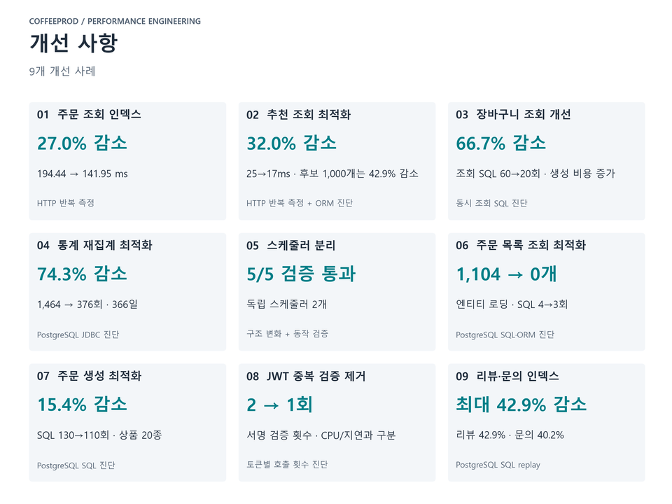

# 성능 개선 포트폴리오 이미지

요약 1장과 사례별 9장, 총 10장의 한국어 PNG다. 각 원본은 2400×1800이며 가로 960px 미리보기를 함께 제공한다.



## 등재용 파일

| 이미지 | 원본 PNG | 960px 미리보기 |
|---|---|---|
| 전체 요약 | [원본](figures/00-summary.png) | [미리보기](previews/00-summary.png) |
| 01. 주문 조회 인덱스 | [원본](figures/01-order-index.png) | [미리보기](previews/01-order-index.png) |
| 02. 추천 조회 최적화 | [원본](figures/02-recommendation.png) | [미리보기](previews/02-recommendation.png) |
| 03. 장바구니 조회 개선 | [원본](figures/03-cart.png) | [미리보기](previews/03-cart.png) |
| 04. 통계 재집계 최적화 | [원본](figures/04-statistics.png) | [미리보기](previews/04-statistics.png) |
| 05. 스케줄러 분리 | [원본](figures/05-schedulers.png) | [미리보기](previews/05-schedulers.png) |
| 06. 주문 목록 조회 최적화 | [원본](figures/06-order-summary.png) | [미리보기](previews/06-order-summary.png) |
| 07. 주문 생성 최적화 | [원본](figures/07-order-create.png) | [미리보기](previews/07-order-create.png) |
| 08. JWT 중복 검증 제거 | [원본](figures/08-jwt.png) | [미리보기](previews/08-jwt.png) |
| 09. 리뷰·문의 인덱스 | [원본](figures/09-review-qna-index.png) | [미리보기](previews/09-review-qna-index.png) |

문제점·코드 개선·측정 조건·정량 결과·삽입 문구는 [사례 설명](CASES.md)을 사용한다. [검증 기록](QA.md)과 [수치·출처](data/portfolio.json)도 함께 보관한다.

## 다른 PC에서 재생성

Python 3.12와 한글 폰트가 필요하다. Windows 기본값은 맑은 고딕이다. 의존성·폰트를 갖춘 뒤 생성기는 네트워크·서버·DB·SSH·k6·Gradle을 사용하지 않는다.

```powershell
py -3.12 -m venv improvement/portfolio/.venv
.\improvement\portfolio\.venv\Scripts\python.exe -m pip install -r improvement/portfolio/requirements-render.txt
.\improvement\portfolio\.venv\Scripts\python.exe improvement/portfolio/scripts/render.py
.\improvement\portfolio\.venv\Scripts\python.exe improvement/portfolio/scripts/verify.py
```

Linux/macOS에서는 가상환경의 `bin/python`을 사용하고 `render.py --font-file <한글 폰트 경로> --bold-font-file <굵은 한글 폰트 경로>`를 지정한다. 실제 폰트 이름·해시와 렌더러 버전은 `data/figure-manifest.json`에 기록한다. 폰트가 다르면 PNG 해시·줄바꿈이 달라질 수 있다.

## 근거와 범위

- `0c26f5d`의 공개용 증빙과 생성 도구를 선별 반영했다. 원래 `build/`, `k6/results`의 비공개 전체 수집본과는 구분한다.
- 641개 보관 증빙의 SHA-256, 비교표 21행과 46개 완료 HTTP 세션의 요청별 p95를 재검산한다. 10월은 기존 정제 자료의 해시·중앙값을 대조한다.
